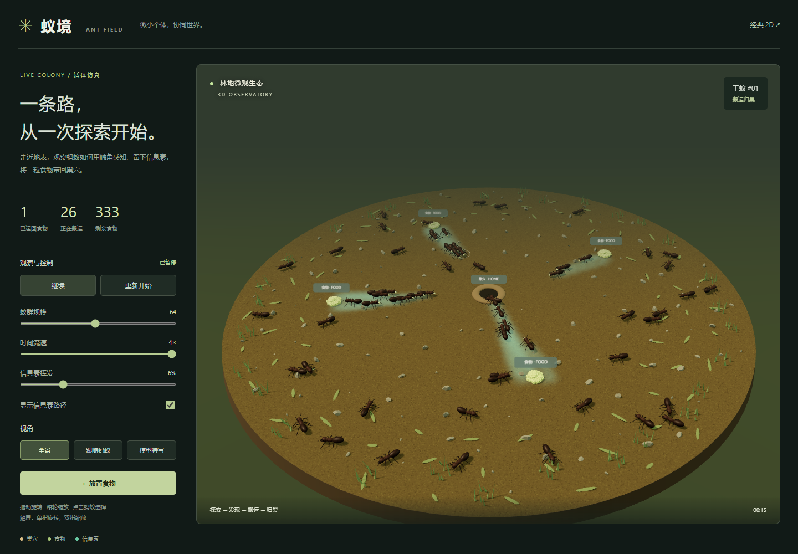
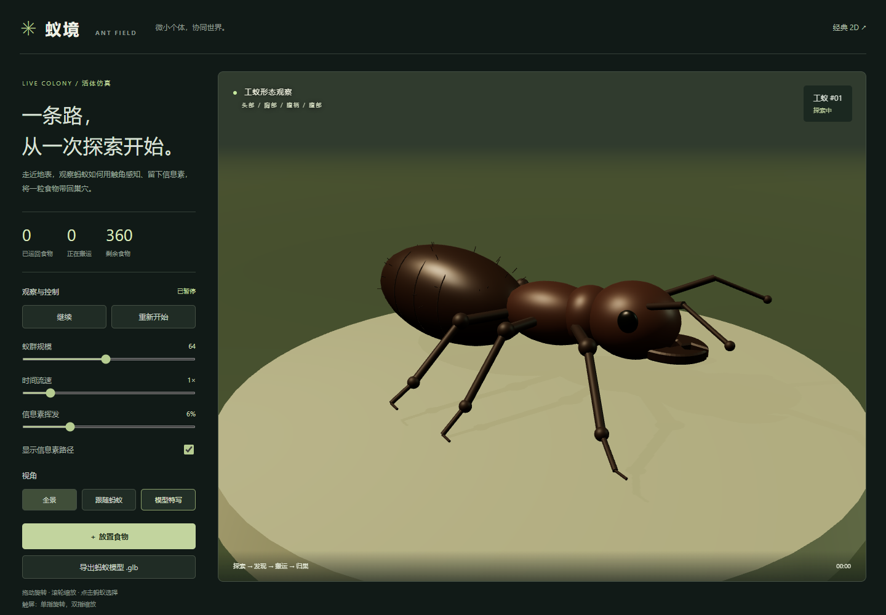

# 蚁境 · Ant Field

浏览器中的 **3D 蚂蚁觅食仿真**。蚂蚁离巢探索，感知附近食物，用大颚夹取食物并搬运归巢；返回时释放信息素，其他工蚁通过局部采样发现路径。信息素持续挥发，食物会被耗尽，行为来自个体规则。



## 启动

需要 Node.js 20.19+ 或 22.12+。

```sh
npm ci
npm run dev
```

打开终端显示的本地地址（通常是 `http://127.0.0.1:5173/`），首页自动进入 3D 观察室。3D 版本使用 JavaScript 模块，需要通过本地服务器运行，不能直接双击 HTML。

```sh
npm test             # 觅食、食物守恒、边界、挥发、重置、时间步进测试
npm run build        # 生成 dist/，可部署到静态服务器
```

浏览器交互检查：先保持开发服务器运行，再执行 `npm run test:browser`。Windows 自动使用已安装的 Edge；其他环境先运行 `npx playwright install chromium`。可用 `ANT_TEST_URL` 指定其他测试地址。检查包含视角切换、暂停、投食、重置、规模调整、实际归巢、GLB 导出和移动端布局。

## 观察与操作

- **全景**：拖动旋转，滚轮缩放；触屏使用单指旋转、双指缩放。点击工蚁可以选择个体。
- **跟随蚂蚁**：持续跟随当前选中的工蚁，观察发现、夹取、搬运和归巢。
- **模型特写**：旋转观察头部、胸部、细腰腹柄、腹部、大颚、复眼与肘状触角。可导出静态 `.glb` 模型，在 Blender 等软件中打开。
- **放置食物**：开启后点击地面添加 60 粒食物；巢口和边缘不可放置，最多同时存在 30 个有效食物点。再次点击按钮或按 Esc 退出。
- **参数**：12–120 只工蚁、0.5–4 倍时间速度、1–20%/秒信息素挥发率。改变蚁群规模会重新开始本次仿真；暂停时可以调整视角和放置食物。



仓库附带可直接导入的静态模型：[worker-ant.glb](assets/worker-ant.glb)。网页中的步态与触角动画由程序实时驱动，不包含在静态 GLB 文件中。

## 模型与行为

模型采用程序化几何构建，包含六条分节足、跗节、腹部缝线和细毛。所有足连接胸部；前后足与另一侧中足形成交替三足步态，步态相位随实际移动距离推进。触角持续摆动，搬运时大颚前可见食物颗粒。

工蚁只有探索和搬运两种主要状态，另有短暂的取食与巢口休整。探索时使用三个前方局部信息素采样点，并在约 5.5 个场景单位内感知食物；距离食物点小于 1.4 单位时取走一粒。搬运速度为探索速度的 78%，返回时释放逐渐减弱的信息素；进入巢口后，已运回数量增加。整个过程中满足：**剩余食物 + 正在搬运 + 已运回 = 初始食物 + 手动添加食物**。

这是自然启发的仿真，**不代表某一物种的解剖扫描或经实验校准的生物学模型**。归巢采用理想化的位置导航；地面装饰没有碰撞，蚂蚁之间也没有实体碰撞。信息素以二维网格计算，蚂蚁与环境以三维显示。群体模型使用共享几何与实例化渲染，降低大量工蚁的绘制开销。

源文件：`src/ant-model.js` 为模型与步态，`src/simulation.js` 为独立行为系统，`src/main.js` 为场景、交互和模型导出。

## 经典 2D 版本

原来的 `ant-foraging.html` 仍可直接双击运行，3D 页面右上角提供入口。原 2D 行为说明见 `规律.md`。

## 发布

`npm run build` 后发布 **dist 目录**。资源路径支持项目子目录，例如 GitHub Pages 的 `/Ant-Foraging/`。3D 版本需要构建后部署，不能继续用 GitHub Pages 的仓库根目录直接托管源文件。此分支没有自动部署配置，不会自动发布线上网站。

Repository: [SUPUZZ/Ant-Foraging](https://github.com/SUPUZZ/Ant-Foraging)
