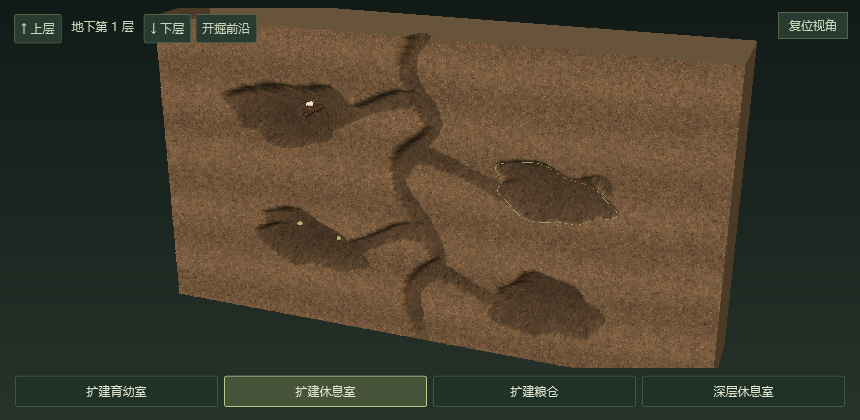

# 桌面蚁境 · Windows 桌面版

这是 Windows 原生桌面版目录，包含程序源码、行为检查、资源、图标工具和发布脚本。网页版位于同级的 `web/`，见 [网页版说明](../web/README.md)；两个版本的入口见 [仓库总览](../README.md)。以下路径与命令均相对于 `desktop/` 目录。


## 直接运行

本地已构建版本位于 `artifacts/windows-x64/AntField.exe`。也可打开 [GitHub Actions 编译记录](https://github.com/SUPUZZ/Ant-Foraging/actions/workflows/build.yml)，进入成功的运行记录，在 **Artifacts** 下载 `AntField-windows-x64`，解压后运行 `AntField.exe`。它是 Windows x64 便携程序，无需安装或管理员权限；完整发布版包含 .NET 运行时。

启动后，蚂蚁和食物直接出现在**所有显示器的桌面工作区域**。蚁窝位于主屏底部中央、任务栏上方。点击蚁窝或系统托盘图标，可查看巢内剖面。蚁窝之外的桌面覆盖层穿透鼠标，不接管键盘焦点。

- **蚁后室**：蚁后和照料工蚁。
- **育幼室**：卵、幼虫、蛹与新工蚁；食物不足时发育暂停。
- **粮仓**：实时储粮，觅食归巢增加储粮，休整、蚁后和育幼会消耗粮食。
- **工蚁休息区**：显示实际在巢内恢复体力的工蚁。


剖面房间可以点击查看详情。关闭剖面窗口只会收起；通过托盘菜单或“退出蚁境”按钮退出。托盘还支持暂停和隐藏桌面蚁群。首次运行从 48 只工蚁开始，育幼可使群体增加，最多 120 只。

最新包的内部窗口提供 3D 切面。内部窗口使用原生 WPF 3D 土层切面，露出凹入的巢室与连通通道，展示立体蚁后、六足工蚁、卵/幼虫/蛹和储粮。拖动调整角度，滚轮缩放，点击巢室或下方房间按钮查看详情；“复位视角”恢复全景。桌面巢口仍不显示文字。

切面的育幼阶段、储粮及巢内工蚁取自实时仿真，蚁后与巢内巡行位置是展示模型。工蚁最多显示 18 只、储粮最多显示 70 粒，完整数量仍在窗口统计中显示。暂停时巢内动画同步停止，窗口收起时停止渲染更新。


`--smoke-test` 同时检查 3D 巢室在不同角度、不同窗口宽度下的射线点击、房间按钮与视角复位，以及离巢工蚁/育幼个体的更新；结果写入 `smoke-results/nest-cutaway-check.json`，测试切面图写入 `nest-cutaway-check.png`。

图标源文件为 `AntField.Desktop/Assets/ant-icon.svg`；修改后安装图标工具的独立依赖并运行，生成 PNG 预览及包含 16–256 像素多种尺寸的 ICO，再重新构建桌面版：

```powershell
cd tools
npm ci
npm run generate:icon
cd ..
```

此工具需要 Node.js 和 Edge（Windows）或 Playwright Chromium；没有 Edge 时，在 `tools/` 执行 `npx playwright install chromium`。仅在重新生成图标时需要这些工具，正常运行与构建使用已有 ICO。

最新包的桌面巢口采用多洞设计。桌面土堆上有三个大小不一的洞口，土层与洞口阴影在蚂蚁下方，蚂蚁经过时不会被土堆盖住；点击土堆仍可打开 3D 内部切面。

## 桌面与窗口规则

桌面移动与巢内动画随 WPF 渲染帧更新，不再用约 30 FPS 的后台计时器刷新位置；实际刷新频率取决于显示器和系统负载。蚂蚁使用独立的保留绘制对象，位置变化只更新对应变换，步态变化时才更换缓存图像；蚁窝和食物不随每次移动重画。窗口检测保持约 0.1 秒一次，统计约 0.2 秒更新，气味轨迹最多每 0.1 秒重画，定时存档在后台写入。窗口遮挡几何与轨迹画刷复用，屏幕或窗口边界变化时才更新遮挡缓存；隐藏窗口时停止可见绘制，暂停时停止移动和巢内动画。

`--smoke-test` 额外输出 `smoke-results/frame-timing.json`，记录渲染能力等级及平均、95 分位、最大帧间隔。`--frame-test` 使用 120 只蚂蚁运行 8 秒，仅展示桌面覆盖层、不打开三维面板，输出同样的帧间隔记录后自动退出。两种检查模式都不读写正常存档，用于区分桌面移动与三维面板的刷新开销。

蚁窝被窗口封住时，外面的工蚁继续在可行走空地探索；携粮工蚁保留食物，在外等待或沿墙移动。巢内工蚁暂停出巢计时，窗口移开后按各自原有计时陆续出发。只有实际被窗口盖住的工蚁进入遮挡避让状态，并选择最近的可见空地，不集体奔向巢口或任务栏下方；单纯封住蚁窝不会清空外面的食物和气味。

窗口拐角使用实际边界检查与邻近导航点衔接，避免把能走的边缘误判成封闭网格。探索时不采样隔着窗口的气味，气味浓度相同不会固定转向；贴墙两秒仍未走出小范围的工蚁会沿可通行路线绕开，保持正常步速与携带的食物。

内部切面的主通道与支路采用连续曲线，宽度与凹入深度沿路径变化。四个巢室错层分布，大小、倾角和凹凸轮廓各不相同；选中轮廓、点击判断及内部个体位置使用同一套巢室几何。原生检查会验证每个巢室均连通地表入口。

程序只读取可见顶层窗口的边界和显示状态，不读取窗口文本或截图。最小化窗口、其他虚拟桌面上被隐藏的窗口、桌面背景和任务栏不会变成墙。

窗口边界仍是墙：工蚁始终在桌面底层活动，遇到窗口沿边界绕行，不爬到窗口表面。搬运工蚁采样周围的信息素，优先走气味较强且朝巢穴推进的局部路线；没有有效气味时，使用可达网格引导归巢。局部路线选择会检查窗口遮挡，窗口布局改变后重新选择。旧存档中的越墙概率不再生效。

随机食物只会出现在巢穴可以到达、距离巢口足够远的桌面空地，最多 9 个食物点。默认以 3 分钟为基础间隔，加 0–60% 随机延迟，每次尝试间隔约 3–4.8 分钟；面板可调基础间隔为 2–10 分钟。剩余食物超过 20 份或已有两个食物点时延后，不反复堆积食物。新蚁群仅投放一处初始食物，恢复存档不额外投放。普通碎屑有 8–19 份；没有大食物时，每次生成有 20% 概率尝试放置一块含 160–280 份的大食物，同一时间最多一块。大食物显示为有纹理的食物块，搬运后逐渐缩小，吃完消失；放置时为完整块状外观预留边界空间，狭窄空地放不下时改为碎屑。

找到食物的工蚁归巢后，再次出发时朝仍有储量的食物方向探索，途中仍受窗口墙约束。空手工蚁沿可见的局部气味向远离蚁窝的方向跟随；搬运工蚁沿途释放气味并向蚁窝前进，大食物支撑反复搬运后可形成稳定的往返路线。气味仍会挥发，食物耗尽后工蚁会重新探索；路线不预先画出，也不为陌生工蚁提供全局食物坐标。


没有合适空地时等待，而不把食物放到窗口上。巢口有一个小型保留平台，确保底部蚁窝可见；窗口铺满桌面时，平台之外不再生成食物。

窗口边界约每 0.1 秒刷新一次。移动或打开窗口覆盖食物后，该食物作废。窗口盖住地面工蚁时，工蚁保留原位置和携带的食物，留在窗口下方的地面，以正常步速向可达边缘爬行，爬出来后继续觅食或归巢。窗口遮挡区域中的身体不会画在窗口表面，身体越过边缘时逐渐显露；窗口移走时，工蚁直接在当前实际位置显露。底部也允许工蚁留在地面，不因窗口移动被挪到其他空地；窗口铺满屏幕时，工蚁可在其下方向底部巢口爬行。食物统计满足 `随机生成 = 桌面剩余 + 搬运中 + 已运回 + 布局变化作废`。

探索依赖附近食物和局部信息素，搬运工蚁沿途释放并利用信息素归巢，信息素持续挥发；疲劳工蚁归巢恢复体力。剖面内的巡行是对巢内活动的示意，储粮、工蚁数量、育幼阶段和新工蚁数量来自同一实时仿真。归巢仍使用理想化的巢穴方向约束，避免沿食物气味倒走或绕圈；不是完全依赖气味的生物学模型。信息素和工蚁的食物来源记忆会随进度保存，重启后继续使用；显示器范围发生变化时会重新建立气味网格，避免把旧路径放到错误位置。育幼时间经过压缩，未实现真实物种的寿命、疾病、死亡、战争或多蚁后机制。

桌面上的蚂蚁复用浏览器版的 **3D 工蚁模型**，预渲染为俯视动画，含 24 个六足步态帧、休息姿态及搬运食物状态。动画随实际移动距离推进；透明桌面层不支持自由旋转个体模型，浏览器中的 3D 特写和导出功能仍在原页面中。支持多显示器的左右、上下排列、负坐标与不同 DPI 缩放，统一物理桌面坐标可跨相邻屏幕觅食归巢，屏幕之间的空隙不可行走；食物避开各屏任务栏，工蚁跨任务栏接缝时从其下方经过。拔掉屏幕后，该屏工蚁转移到最近可用屏幕。不保证覆盖独占全屏游戏或安全桌面。

## 存档

每 30 秒和正常退出时自动保存，也可点击“立即保存”。面板显示累计仿真时间、累计羽化及最近保存时间；失败时明确提示，可稍后重试。下次启动恢复工蚁、体力和休息计时、储粮、大小食物、育幼状态、气味路径、食物来源记忆，以及速度、暂停和显示选项。巢穴开掘、出口扩张、产卵、消耗和下一次食物出现的计时也会恢复，启动时不再额外补充食物。更新后的窗口布局会重新验证位置；旧版存档仍可读取。

主存档位于 `%LOCALAPPDATA%\AntField\colony.json`，采用临时文件与原子替换保存，上一份成功进度保留在 `colony.backup.json`。主存档损坏时尝试恢复备份；两份均无法读取时，面板显示无法恢复的提示。

这是同一蚁群的长期观察系统，不提供重建/重置蚁群入口。旧版保存的蚁群直接接续，旧的秒级自动投食间隔迁移为分钟级，旧历史文件仍可查看。正常退出先等待后台保存结束，再保存最新状态；重新打开恢复累计进度和开掘状态。软件关闭期间不推进仿真。

## 持续发展的巢穴

始终只有一只蚁后，留在主巢的蚁后室。巢穴按实际工蚁规模、平均体力及储粮积累开掘劳动；缺粮（储粮不超过 2）或平均体力不超过 30 时停止扩建。健康且粮食充足的 48 只工蚁，约需 2.24 小时仿真时间完成首个新巢室，后续巢室的开掘成本逐渐增加。实际状态通常需要更久；暂停时不增长。

主巢之外按每层四个巢室向地下继续发展，没有最终等级或固定层数上限。“上层”“下层”“开掘前沿”切换查看已经开掘的 3D 切面。每层形状由层编号确定：弯曲主轴、支路、不规则巢室和后续旁路逐渐形成；开掘过程先延伸通道，再掏空巢室。只生成当前层的网格，层数增加不会累积渲染对象。育幼、储粮和巢内工蚁按已开掘层分配，统计仍显示整个蚁群的数量，不额外生成蚁后。



桌面三个出口随同一劳动预算缓慢扩大，最初一小时变化约 1%，接近完整扩张需要数天至数周，粮食和体力不足会更慢。出口的宽度、深度变化受土堆空间约束，保持低矮、无文字的外观；进度与出口尺寸在重启后接续。育幼时间仍为压缩仿真，工蚁数量保持最多 120 只，以控制桌面负载；巢穴扩建可在此规模下继续，不以人口上限作为最终等级。

原生检查同时验证没有重建按钮、扩建巢层的实际凹入深度与入口连通、唯一蚁后、出口长期变化。`--persistence-test` 使用包内 `smoke-results/persistence/` 的独立存档运行两秒后正常退出，重复执行可验证退出保存及恢复；它不读写正常用户存档。

## 从源码构建

需要 Windows 10/11 和 .NET 8 SDK。

```powershell
dotnet run --project AntField.Desktop
dotnet run --project AntField.Core.Tests -c Release
./build.ps1
```

`build.ps1` 先执行行为测试，再生成自包含单文件程序；加 `-FrameworkDependent` 可生成较小的程序，但运行机器需安装 .NET 8 Desktop Runtime。

```powershell
./artifacts/windows-x64/AntField.exe --smoke-test
```

原生检查模式运行 3 秒，检查透明窗口、屏幕/DPI、真实窗口检测、食物有效位置，以及单个/重叠窗口、旧爬墙状态的像素遮挡和窗口移动、移走后的显露，输出 `smoke-results/native-check.json` 与 `nest-interior.png`，不读写正常存档。`--ui-test` 将该模式延长至 60 秒，方便验证交互。

结构：`AntField.Core` 是无需窗口的行为与导航系统，`AntField.Core.Tests` 是独立行为检查，`AntField.Desktop` 负责 Win32 窗口边界、透明层、托盘、剖面和存档。

桌面动画素材 `AntField.Desktop/Assets/ant-atlas.png` 已经内嵌，正常运行与构建不依赖网页项目、Node.js、联网或浏览器。若要更新复用的 3D 模型素材，修改 `../web/src/ant-model.js` 后，在 `../web/` 启动 `npm run dev`，再在另一个终端的 `web/` 目录执行 `npm run generate:desktop-atlas`，生成素材后重新构建桌面程序。详见 [网页版素材工具说明](../web/README.md#桌面动画素材生成可选)。
