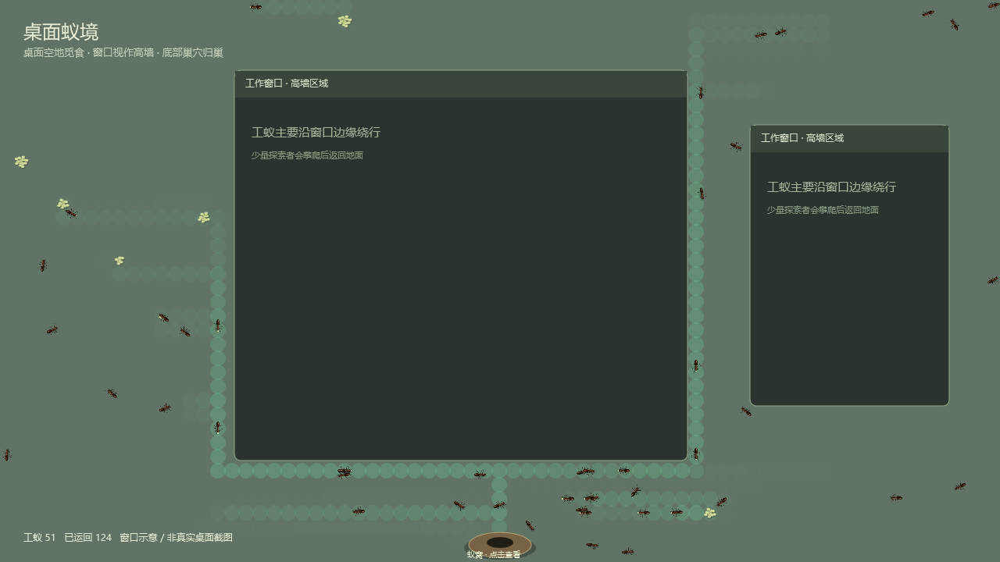
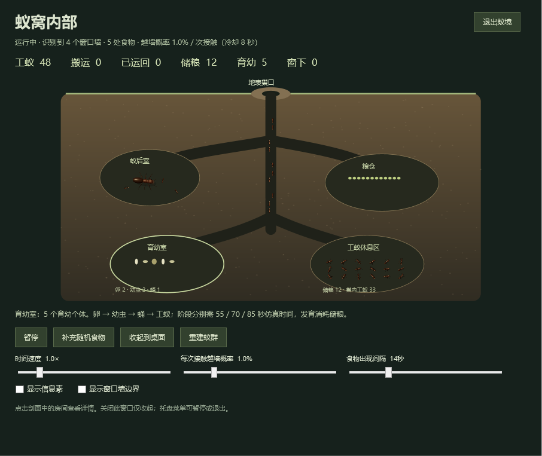

# 桌面蚁境 · Windows 桌面版

此分支从 `codex/realistic-3d-ant-foraging` 创建，新增独立的 Windows 原生桌面程序，保留已有浏览器 3D 版本。



## 直接运行

已构建版本位于 `desktop/artifacts/windows-x64/AntField.exe`。它是 Windows x64 便携程序，无需安装或管理员权限；完整发布版包含 .NET 运行时。

窗口遮挡规则修正版为 `desktop/artifacts/windows-x64-occlusion/AntField.exe`。使用前从托盘退出正在运行的旧版，再打开修正版；修正版会读取同一个蚁群存档。

启动后，蚂蚁和食物直接出现在**所有显示器的桌面工作区域**。蚁窝位于主屏底部中央、任务栏上方。点击蚁窝或系统托盘图标，可查看巢内剖面。蚁窝之外的桌面覆盖层穿透鼠标，不接管键盘焦点。

- **蚁后室**：蚁后和照料工蚁。
- **育幼室**：卵、幼虫、蛹与新工蚁；食物不足时发育暂停。
- **粮仓**：实时储粮，觅食归巢增加储粮，休整、蚁后和育幼会消耗粮食。
- **工蚁休息区**：显示实际在巢内恢复体力的工蚁。



剖面房间可以点击查看详情。关闭剖面窗口只会收起；通过托盘菜单或“退出蚁境”按钮退出。托盘还支持暂停和隐藏桌面蚁群。首次运行从 48 只工蚁开始，育幼可使群体增加，最多 120 只。

最新信息素归巢版：`desktop/artifacts/windows-x64-pheromone/AntField.exe`。退出托盘旧版后启动。

## 桌面与窗口规则

程序只读取可见顶层窗口的边界和显示状态，不读取窗口文本或截图。最小化窗口、其他虚拟桌面上被隐藏的窗口、桌面背景和任务栏不会变成墙。

窗口边界仍是墙：工蚁始终在桌面底层活动，遇到窗口沿边界绕行，不爬到窗口表面。搬运工蚁采样周围的信息素，优先走气味较强且朝巢穴推进的局部路线；没有有效气味时，使用可达网格引导归巢。局部路线选择会检查窗口遮挡，窗口布局改变后重新选择。旧存档中的越墙概率不再生效。

随机食物只会出现在巢穴可以到达、距离巢口足够远的桌面空地，最多 9 个食物点。默认每 14 秒尝试生成一次。没有合适空地时等待，而不把食物放到窗口上。巢口有一个小型保留平台，确保底部蚁窝可见；窗口铺满桌面时，平台之外不再生成食物。

窗口边界约每 0.1 秒刷新一次。移动或打开窗口覆盖食物后，该食物作废。窗口盖住地面工蚁时，工蚁保留原位置和携带的食物，留在窗口下方的地面，以正常步速向可达边缘爬行，爬出来后继续觅食或归巢。窗口遮挡区域中的身体不会画在窗口表面，身体越过边缘时逐渐显露；窗口移走时，工蚁直接在当前实际位置显露。底部也允许工蚁留在地面，不因窗口移动被挪到其他空地；窗口铺满屏幕时，工蚁可在其下方向底部巢口爬行。食物统计满足 `随机生成 = 桌面剩余 + 搬运中 + 已运回 + 布局变化作废`。

探索依赖附近食物和局部信息素，搬运工蚁沿途释放并利用信息素归巢，信息素持续挥发；疲劳工蚁归巢恢复体力。剖面内的巡行是对巢内活动的示意，储粮、工蚁数量、育幼阶段和新工蚁数量来自同一实时仿真。归巢仍使用理想化的巢穴方向约束，避免沿食物气味倒走或绕圈；不是完全依赖气味的生物学模型。信息素不写入存档，重启后由工蚁重新建立。育幼时间经过压缩，未实现真实物种的寿命、疾病、死亡、战争或多蚁后机制。

桌面上的蚂蚁复用浏览器版的 **3D 工蚁模型**，预渲染为俯视动画，含 24 个六足步态帧、休息姿态及搬运食物状态。动画随实际移动距离推进；透明桌面层不支持自由旋转个体模型，浏览器中的 3D 特写和导出功能仍在原页面中。支持多显示器的左右、上下排列、负坐标与不同 DPI 缩放，统一物理桌面坐标可跨相邻屏幕觅食归巢，屏幕之间的空隙不可行走；食物避开各屏任务栏，工蚁跨任务栏接缝时从其下方经过。拔掉屏幕后，该屏工蚁转移到最近可用屏幕。不保证覆盖独占全屏游戏或安全桌面。

## 存档

每 30 秒和正常退出时自动保存至 `%LOCALAPPDATA%\AntField\colony.json`。下次启动恢复工蚁、储粮、食物、育幼状态。更新后的窗口布局会重新验证位置。存档损坏时启动新蚁群。

## 从源码构建

需要 Windows 10/11 和 .NET 8 SDK。

```powershell
dotnet run --project desktop/AntField.Desktop
dotnet run --project desktop/AntField.Core.Tests -c Release
./desktop/build.ps1
```

`build.ps1` 先执行行为测试，再生成自包含单文件程序；加 `-FrameworkDependent` 可生成较小的程序，但运行机器需安装 .NET 8 Desktop Runtime。

运行旧版本时，可用 `./desktop/build.ps1 -OutputDirectory artifacts/windows-x64-occlusion` 构建到其他目录，避免替换正在使用的程序。

```powershell
./desktop/artifacts/windows-x64/AntField.exe --smoke-test
```

原生检查模式运行 3 秒，检查透明窗口、屏幕/DPI、真实窗口检测、食物有效位置，以及单个/重叠窗口、旧爬墙状态的像素遮挡和窗口移动、移走后的显露，输出 `smoke-results/native-check.json` 与 `nest-interior.png`，不读写正常存档。`--ui-test` 将该模式延长至 60 秒，方便验证交互。

结构：`AntField.Core` 是无需窗口的行为与导航系统，`AntField.Core.Tests` 是独立行为检查，`AntField.Desktop` 负责 Win32 窗口边界、透明层、托盘、剖面和存档。

桌面动画素材已经内嵌，无需联网或浏览器。修改 `src/ant-model.js` 后，先启动 `npm run dev`，再运行 `node desktop/tools/generate-ant-atlas.js` 重新生成素材，然后重新构建桌面程序。
